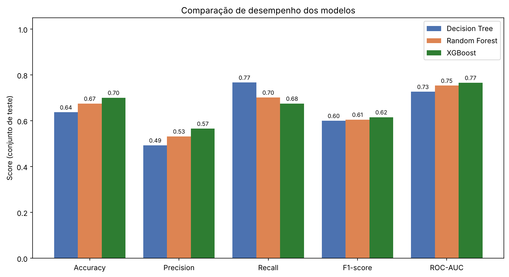
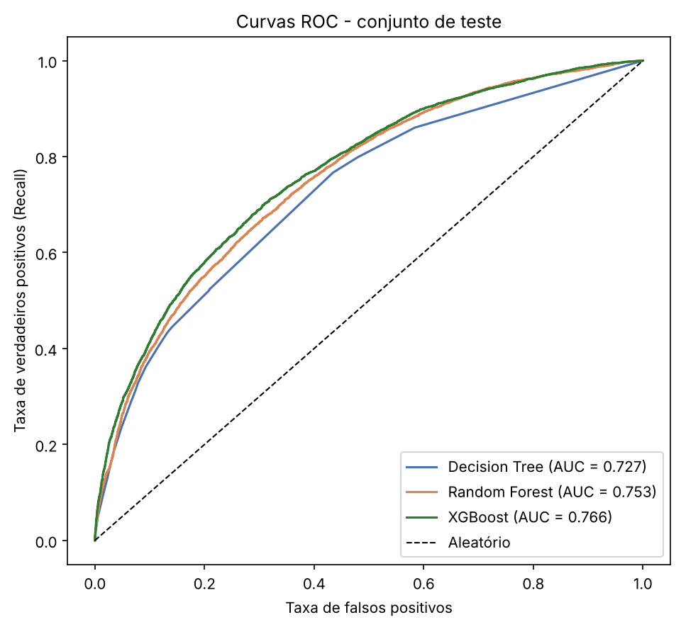
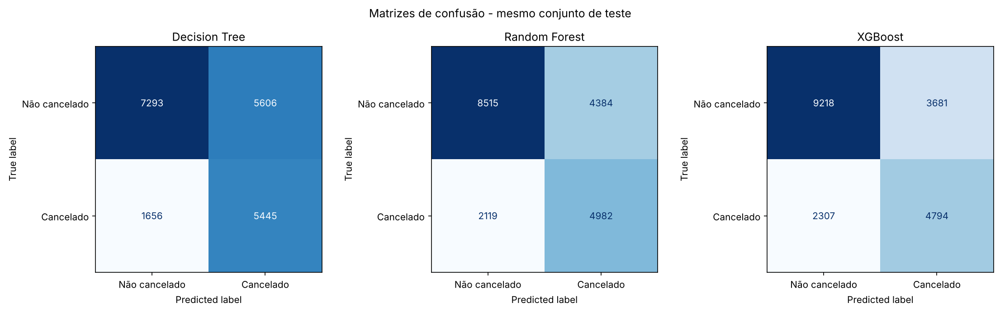

# Order Cancellation Prediction

Machine Learning project that predicts whether an e-commerce order will be **cancelled**, comparing three
tree-based classifiers — **Decision Tree**, **Random Forest** and **XGBoost** — under exactly the same conditions
(same data, same train/test split, same preprocessing, same metrics).


> **Data note:** the datasets appear to be **simulated** (see [`data/sample/README.md`](data/sample/README.md)).
> This is an educational / portfolio project; its results say nothing about any real business.

---

## Problem and business objective

Cancelled orders mean lost revenue, wasted logistics and customer-service effort. If the orders most likely to be
cancelled are identified **at the moment they are placed**, the business can act early: confirm the payment, contact the
customer, review stock, or prioritise follow-up.

**ML task:** binary classification (`cancelado` = 1 if the order was cancelled). The model returns a predicted class and a
cancellation score for each order.

## Technologies

Python · pandas · NumPy · scikit-learn (`Pipeline`, `ColumnTransformer`, `OneHotEncoder`) · XGBoost · Matplotlib · Jupyter

## Project structure

```
previsao-cancelamento-vendas/
├── README.md
├── requirements.txt
├── .gitignore
├── data/
│   ├── raw/                  # full datasets go here (NOT versioned) -> see data/raw/README.md
│   └── sample/               # versioned samples (5,000 + 1,000 orders) and the small original "vendas" dataset
├── notebooks/
│   └── analise_exploratoria.ipynb   # exploratory data analysis (executed, outputs included)
├── src/
│   ├── common.py             # data loading, split, preprocessing pipeline, metrics, plots
│   ├── decision_tree.py      # Decision Tree
│   ├── random_forest.py      # Random Forest
│   ├── xgboost_model.py      # XGBoost
│   ├── compare_models.py     # runs the 3 models on the same test set + comparison table/plots
│   └── make_samples.py       # regenerates data/sample from the full data
├── results/
│   ├── comparison/           # comparison table, bar chart, ROC curves, confusion matrices
│   ├── decision_tree/        # metrics.json, feature importance, confusion matrix, tree plot (+ original/)
│   ├── random_forest/        # idem, with an example tree from the forest (+ original/)
│   └── xgboost/              # idem (+ original/)
└── docs/
    └── metodologia.md        # technical decisions, leakage review, limitations
```

## Methodology (summary)

Full details and the reasoning behind each decision are in [`docs/metodologia.md`](docs/metodologia.md).

1. **Single split for all models:** stratified 80/20 split (`random_state=42`) → 80,000 train / 20,000 test orders.
2. **No leakage in preprocessing:** median/mode imputation and One-Hot Encoding live inside a scikit-learn `Pipeline`
   and are fitted **only on the training set**. Categories unseen in training are ignored instead of breaking the model.
3. **Class imbalance (35.5% cancelled):** `class_weight="balanced"` (Decision Tree, Random Forest) and
   `scale_pos_weight` computed on the training set (XGBoost).
4. **Feature engineering:** month, weekend flag and period of the day, derived from the order date/hour.
5. **Hyperparameters** are the ones from the original scripts — **not tuned**; the goal is a fair comparison.
6. **Metrics** computed at run time on the test set: Accuracy, Precision, Recall, F1-score, ROC-AUC and the confusion matrix.

## Results

The table below was produced by `python src/compare_models.py` on the **full dataset (100k orders)**, with a test set of
20,000 orders (7,101 cancelled). Positive class = cancelled.

| Model | Accuracy | Precision | Recall | F1-score | ROC-AUC | TN | FP | FN | TP |
|---|---|---|---|---|---|---|---|---|---|
| Decision Tree | 0.6369 | 0.4927 | 0.7668 | 0.5999 | 0.7267 | 7293 | 5606 | 1656 | 5445 |
| Random Forest | 0.6748 | 0.5319 | 0.7016 | 0.6051 | 0.7534 | 8515 | 4384 | 2119 | 4982 |
| XGBoost | 0.7006 | 0.5657 | 0.6751 | 0.6156 | 0.7658 | 9218 | 3681 | 2307 | 4794 |



| ROC curves | Confusion matrices |
|---|---|
|  |  |

> The full 100k files are **not** in this repository. Cloning the repo and running the code uses the versioned
> **sample** (1,000-order test set), which gives different, noisier numbers than the table above. The scripts print a
> warning when they run on the sample.

### How to interpret the results

* **XGBoost** has the best Accuracy, Precision, F1-score and ROC-AUC. **Decision Tree** has the highest Recall, but it
  gets there by flagging more orders: it labels 11,051 of the 20,000 test orders (55%) as "will be cancelled", against
  8,475 (42%) for XGBoost, while only 35.5% are really cancelled. That is why its precision is the lowest (49%).
* **Precision** tells how many of the flagged orders are really cancelled (XGBoost: 57%); **Recall** tells how many of the
  real cancellations are caught (XGBoost: 68%). Which of the two matters more depends on the cost of an intervention
  versus the cost of a missed cancellation — a business decision.
* **ROC-AUC ≈ 0.77** (XGBoost) means that, if one cancelled and one non-cancelled order are picked at random, the model
  gives the higher score to the cancelled one about 77% of the time. It is a moderate result: in the exploratory analysis no
  single feature stands out (best univariate AUC ≈ 0.63).
* The F1-scores are close (0.600 / 0.605 / 0.616). The differences were **not** tested for statistical significance, so
  the ranking among models should not be over-interpreted.
* With class weighting the output probabilities are **not calibrated**: use them to rank orders, not as literal
  probabilities. The 0.5 decision threshold was not tuned.
* **Feature importance** (`results/<model>/feature_importance.*`) shows which variables each model used most — e.g.
  `forma_pagamento_boleto`, `cliente_novo`, `estoque_disponivel_no_ato`, `abriu_chamado_suporte` and
  `num_compras_anteriores` appear near the top for XGBoost. It describes the model, not causal effects, and the
  measures are not comparable between models (impurity-based for Decision Tree/Random Forest, gain-based for XGBoost).

## Getting started

### 1. Install

```bash
git clone <your-repository-url>
cd previsao-cancelamento-vendas

python -m venv .venv
source .venv/bin/activate        # Windows: .venv\Scripts\activate
pip install -r requirements.txt
```

### 2. (Optional) add the full data

Without it, everything runs on the samples in `data/sample/`. To use the full data, put `pedidos_completo_100k.csv` and
`pedidos_novos_50k.csv` in `data/raw/` ([instructions](data/raw/README.md)), or pass `--data-dir /path/to/folder`.

### 3. Run

```bash
python src/compare_models.py      # the 3 models + comparison table and plots  (recommended)

python src/decision_tree.py       # or run each model on its own
python src/random_forest.py
python src/xgboost_model.py
```

Common options (all scripts): `--dataset pedidos|vendas` (default `pedidos`) and `--data-dir PATH`. `--output-dir PATH`
sets where a model script writes its files; in `compare_models.py` it only sets the folder of the comparison files
(each model still writes to `results/<model>/`).

Each model writes to `results/<model>/`: `metrics.json`, `feature_importance.csv/.png`, `confusion_matrix.png`, a tree
drawing (Decision Tree / Random Forest) and `predictions_new.csv` — the cancellation prediction and score for every
order in the "new orders" file (ignored by Git). `compare_models.py` also writes `results/comparison/`.

### 4. Exploratory analysis

```bash
pip install jupyterlab
jupyter lab notebooks/analise_exploratoria.ipynb
```

The notebook stored in the repository was executed on the sample data.

### Environment

Tested on Python 3.12 with two stacks: pandas 3.0.6 / numpy 2.5.4 / scikit-learn 1.9.1 / xgboost 3.4.1 / Matplotlib 3.11
(published results) and pandas 2.2.3 / numpy 2.0.2 / scikit-learn 1.6.1 / xgboost 2.1.4 / Matplotlib 3.9.4 (oldest
versions declared in `requirements.txt`). Other Python 3 versions were not tested.

## Limitations

* **Simulated data and unknown provenance** — conclusions describe the data, not a real business.
* **Possible leakage by timing:** some of the most important features (`abriu_chamado_suporte`,
  `tempo_aprovacao_pagamento_horas`, `estoque_disponivel_no_ato`, `taxa_cancelamento_historica_cliente`) must be
  confirmed to be known *when the prediction would be made*; otherwise real performance would be lower than shown.
* **Random (not temporal) validation** — performance on future periods is unknown.
* **No hyperparameter tuning, cross-validation, threshold selection or probability calibration.**
* The results table comes from the full dataset, which is not distributed here; the repository sample reproduces the
  pipeline, not the exact numbers.
* The `results/<model>/original/` plots come from the original scripts (different data/preprocessing) and are kept only
  for reference.

More details in [`docs/metodologia.md`](docs/metodologia.md).
